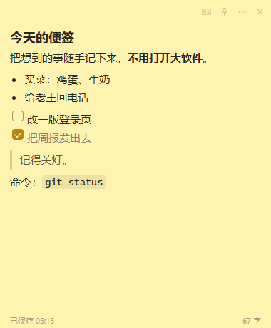
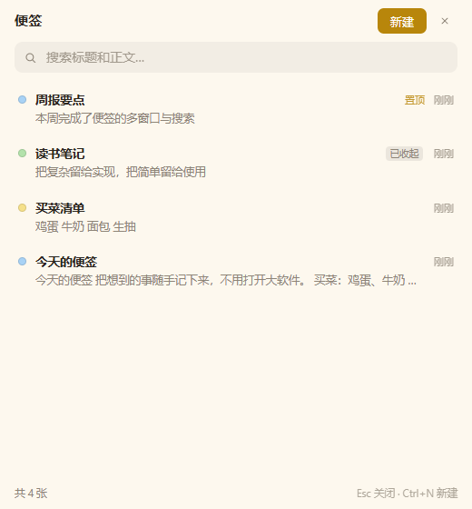

# QuickNote · 桌面便签

用 **AutoHotkey v2 + WebView2 + SQLite** 写的桌面便签。每张便签是一个独立的无边框小窗口，
可以半透明、可换色、可置顶、能贴在任何程序上面；正文支持富文本和 Markdown，实时落库。

```
双击 note.ahk  →  Ctrl+Alt+N 新建  →  Ctrl+Alt+L 看全部
```

| 一张便签 | 便签列表 |
|---|---|
|  |  |

> 上面两张是程序真实渲染出来的截图（`tools/probe-shot.ahk` 用 WebView2 的 CapturePreview 导出），
> 不是设计稿。便签窗口在透明模式下还能透出背后的桌面，截图里看不出来。

---

## 快速开始

### 开发调试：用 run.bat（推荐先走这条）

双击 `run.bat`。它用项目自带的运行时跑 `note.ahk` 脚本版，并且：

- 语法错误、运行时错误会**直接打在窗口里**（编译版看不到，一崩就没了）
- 改完 `.ahk` 或 `ui\` 下的文件，关掉窗口重开就生效，不用重新编译
- 注意：关掉那个命令行窗口 = 退出程序

### 直接运行（需要 AutoHotkey v2）

1. 装 [AutoHotkey v2](https://www.autohotkey.com/)（或者直接用项目自带的 `runtime\AutoHotkey64.exe`）
2. 双击 `note.ahk`
3. 托盘出现一个黄色便签图标，屏幕上会弹出第一张便签

用自带运行时启动：

```bat
runtime\AutoHotkey64.exe note.ahk
```

### 编译版

`dist\QuickNote.exe` 是编译好的单文件程序（仍需机器上有 WebView2 Runtime，Win10 1803+ 基本都自带）。
双击即用，不用装 AutoHotkey。

**编译版出问题时的排查顺序**：先看 `dist\crash.log`（启动失败会写在这里，同时弹框提示），
再看数据目录里的 `app.log`（托盘菜单「打开日志」可以直接打开）。还是定位不了，就用
`run.bat` 跑同一份脚本——同样的错误在命令行里会带文件行号。

---

## 能做什么

| 能力 | 说明 |
|---|---|
| 多张便签 | 每张是独立顶层窗口，可单独拖动、缩放、置顶、收起、删除 |
| 无边框 + 圆角 | 拖动用系统移动循环（`-webkit-app-region`），缩放用右下角手柄 |
| 半透明 | 卡片能透出桌面（窗口用 `WS_EX_LAYERED`+`WS_EX_NOREDIRECTIONBITMAP`，页面用 rgba 自绘） |
| 六种颜色 | 黄 / 粉 / 蓝 / 绿 / 紫 / 灰，随时切换，颜色存在库里 |
| 富文本 | 加粗、斜体、删除线、标题、列表、待办勾选、行内代码、引用 |
| Markdown | `Ctrl+M` 在所见即所得和源码之间切换，两边双向转换 |
| 自动保存 | 停止输入 400ms 自动落库，关窗/收起/失焦时补一次 |
| 位置记忆 | 关掉重开，位置、尺寸、颜色、置顶状态都还原 |
| 列表与搜索 | `Ctrl+Alt+L` 打开总览，按关键字全文搜索（含已收起的便签） |
| 右键菜单 | 便签和列表都支持，用的是系统原生菜单（能超出小窗口边界） |
| 托盘常驻 | 全局热键随时新建/呼出，关掉便签窗口不退出进程 |

### 快捷键

便签窗口内：

| 按键 | 作用 |
|---|---|
| `Ctrl+B` / `Ctrl+I` / `Ctrl+U` | 加粗 / 斜体 / 下划线 |
| `Ctrl+S` | 立即保存 |
| `Ctrl+M` | 切换 Markdown 源码 |
| `Esc` | 失焦、保存 |

全局：

| 按键 | 作用 |
|---|---|
| `Ctrl+Alt+N` | 新建便签 |
| `Ctrl+Alt+L` | 打开便签列表 |
| `Ctrl+Alt+H` | 全部收起 / 再按全部显示 |

列表窗口内：

| 按键 | 作用 |
|---|---|
| `Ctrl+N` | 新建便签（宿主级条件热键，页面里那套也保留了作兜底） |
| `Enter` | 打开第一条（搜索框里按） |
| `Esc` | 清空搜索词；再按一次关窗 |

### 便签上的按钮

右上角四个小图标（鼠标移上去才显示）：

- `M↓` 切换 Markdown 源码
- 📌 置顶（置顶后窗口始终在最前）
- `⋯` 更多菜单，和右键菜单是同一个
- `×` 删除这张便签（不可撤销）

右下角有缩放手柄，拖它调整大小。

### 右键菜单

**便签窗口**（在窗口任意位置右键，或点 `⋯`）：

```
新建便签
便签列表…
────────────
置顶 / 取消置顶
颜色  ›        黄 / 粉 / 蓝 / 绿 / 紫 / 灰（当前色打勾）
────────────
切换 Markdown 源码（源码模式下变成"切换到富文本编辑"）
复制全文
────────────
收起这张
删除这张…      带二次确认
```

**列表窗口**（右上角是「新建 / ⋯ / 关闭」，Esc 也能关）：

- 在某一行的任意位置右键 → `打开 / 置顶·取消置顶 / 颜色› / 收起这张 / 删除…`
- 在空白处或标题栏右键（也可以点右上角 `⋯`）→ `新建便签 / 刷新列表 / 全部显示 / 全部收起 / 打开数据目录`

菜单是系统原生的（`Menu.Show`），不是页面自己画的：便签窗口最小能缩到 180×140，
页面内的菜单根本放不下九项，只有原生菜单能超出窗口边界。代价是菜单打开期间
主线程被占着（原生菜单的固有行为），关掉就恢复。

---

## 配置

首次运行会在数据目录生成 `config.ini`（带中文注释）。改完重启生效。

```ini
[appearance]
transparent=1        ; 1=半透明卡片  0=不透明实色
fontSize=15          ; 正文字号（像素）
drag=native          ; native=系统拖动（默认）  manual=AHK 自己跟鼠标

[window]
width=300            ; 新建便签的默认宽
height=280
color=yellow         ; yellow/pink/blue/green/purple/gray

[hotkey]
new=^!n              ; 留空表示不注册
list=^!l
toggle=^!h

[debug]
devtools=0           ; 1=允许 F12 打开开发者工具
```

托盘菜单里也有「透明外观」开关，会直接改 `transparent` 并重建所有窗口。

---

## 数据存在哪

默认：`%APPDATA%\QuickNote\`

```
%APPDATA%\QuickNote\
  notes.db        便签内容（SQLite，WAL 模式）
  config.ini      配置
  app.log         运行日志（出问题先看这个）
  webview2\       所有 WebView2 共用的 user data folder
```

**便携模式**：在程序目录放一个 `portable.txt`，数据就改存到 `程序目录\data\`，可以整个拷走。

备份就是拷 `notes.db`（记得先退出程序，或者连 `notes.db-wal` 一起拷）。

---

## 透明外观：如果显示不正常

透明这条路有两个必踩的坑，都已经修好并写进了「实现笔记」，这里只说怎么回退：

如果便签窗口出现**黑底、全黑、或者内容看不见**：

1. 托盘菜单 → 取消「透明外观」（或者把 `config.ini` 里 `transparent` 改成 `0`）
2. 程序会重建成不透明实色窗口，其他功能不受影响

默认按透明启动，是因为它在绝大多数本机环境下效果更好。个别显卡驱动 / 远程桌面会话下
WebView2 的合成确实会有差异，这时才需要退回不透明。

---

## 已知限制

- **每张便签约占 45~50MB 内存**（一个 WebView2 渲染进程），10 张 ≈ 0.8GB。浏览器进程组
  （约 300MB）是所有便签共享的，只付一次。
- **收起的便签仍然占内存**：收起只是隐藏窗口，渲染进程还在。想彻底释放就删除它。
- **透明窗口没有系统阴影**：阴影只能画在窗口内部（往外画会被窗口边界裁掉），所以用的是内阴影 + 描边。
- **Win10 上四角可能露出方形底色**：DWM 圆角是 Win11 才有的，Win10 走 CSS 圆角。
- **不支持粘贴图片**：可以放图片链接 / Markdown 图片语法，但没有把剪贴板位图落盘的能力。
- **搜索是 `LIKE` 匹配**：几千张便签以内都很快；再大就需要 FTS5 索引。
- **单显示器缩放切换**：开了 PerMonitorV2，但跨不同缩放的屏幕拖动时可能有轻微模糊，松开鼠标后恢复。
- **打开右键菜单时窗口会短暂"卡住"**：原生菜单是同步的，菜单开着期间主线程不处理其他消息
  （其他便签也不响应），关掉菜单立刻恢复。这是 `Menu.Show()` 的固有行为。

---

## 目录结构

```
wv2-notes/
├─ note.ahk              主程序：单实例、托盘、热键、启动装载
├─ run.bat               ★ 开发调试入口：脚本模式跑，错误直接打在窗口里
├─ lib/
│  ├─ sqlite.ahk         SQLite 封装（优先用系统 winsqlite3.dll）
│  ├─ store.ahk          数据访问层（表结构、CRUD、搜索）
│  ├─ note-window.ahk    一张便签 = 一个 Gui + 一个 WebView2
│  ├─ list-window.ahk    列表面板（单例）
│  ├─ win.ahk            窗口外观（透明/圆角/工作区/级联落点）
│  ├─ json.ahk           极简 JSON（只处理扁平字段）
│  ├─ WebView2/          WebView2 AHK 绑定（第三方，v2.0.5）
│  └─ WebView2Loader.dll
├─ ui/
│  ├─ note.html/css/js   便签页面
│  ├─ list.html/css/js   列表页面
│  └─ md.js              Markdown ⇄ HTML（纯函数，可单测）
├─ assets/note.ico       图标
├─ runtime/              自带的 AutoHotkey 运行时
├─ tools/                冒烟测试、端到端测试、图标生成
├─ tests/md.test.js      Markdown 单测
└─ docs/
```

---

## 开发与测试

```bash
# Markdown 渲染 / 纯文本提取 / 标题提取
node tests/md.test.js

# 单窗口冒烟（真 WebView2，会写 data\_win.log）
runtime\AutoHotkey64.exe tools\probe-window.ahk

# 端到端：输入→防抖→落库→切模式→改色→几何→重开（27 项断言）
runtime\AutoHotkey64.exe tools\e2e.ahk

# 列表面板：渲染/搜索/回调（11 项断言）
runtime\AutoHotkey64.exe tools\probe-list.ahk

# 列表顺序稳定性：编辑/打开/搜索都不许改变顺序（10 项断言，很快）
runtime\AutoHotkey64.exe tools\probe-sort.ahk

# 回归"点完新建就拖不动"：真鼠标点「新建」再拖两个窗口（8 项断言，需先启动 run.bat）
runtime\AutoHotkey64.exe tools\probe-newbug.ahk

# 菜单：回调参数个数、闭包、菜单项是否都包了包装器（41 项断言，很快）
runtime\AutoHotkey64.exe tools\probe-menu.ahk

# 程序级自检：收起全部→全部显示，看窗口是不是真回到屏幕上
runtime\AutoHotkey64.exe note.ahk --selftest-showall

# 程序级自检：把菜单弹出来（会一直开着，Ctrl+C 或关掉即可）
runtime\AutoHotkey64.exe note.ahk --selftest-menu

# 程序级自检：Ctrl+N 链路（热键注册 + 条件判定 + 延迟建窗不卡死）
runtime\AutoHotkey64.exe note.ahk --selftest-keys

# 数据层
runtime\AutoHotkey64.exe tools\probe-store.ahk

# 分层窗口命中测试：不改代码也能确认"看得见的东西点得到"（10 项断言）
runtime\AutoHotkey64.exe tools\probe-hit.ahk

# 对**正在运行**的程序做交互验收：真鼠标拖顶栏 + 点按钮改库（需先启动 run.bat）
runtime\AutoHotkey64.exe tools\probe-live.ahk
runtime\AutoHotkey64.exe tools\probe-click.ahk

# 半透明是否真的生效：压在黑底/桌面各量一次像素
runtime\AutoHotkey64.exe tools\probe-blend.ahk

# 抓桌面截图（PowerShell 的 Add-Type 被安全策略挡了，这里用 GDI 自己写 BMP）
runtime\AutoHotkey64.exe tools\shot-screen.ahk out.bmp 0 0 800 600
```

测试脚本都用 `data\_*.db`，不会碰你的真实便签。

重新生成图标：

```powershell
pwsh -File tools/make-icon.ps1
```

脚本会输出 `assets/note-16…256.png`；重新打包成 ICO 需要把这几个尺寸按 PNG-in-ICO 结构
重新拼一次（图标只在改视觉时才需要重做，平时不用管）。

---

## 实现笔记（维护前值得知道的坑）

这些都是实际调试出来的，改代码时容易再踩：

1. **窗口必须先显示，再建 WebView2 controller。** 在隐藏窗口上创建，页面能加载、
   `CapturePreview` 也有内容，但视觉树不会挂到窗口上 —— 屏幕上就是一个纯白空窗。

2. **`DefaultBackgroundColor` 的 alpha 只接受 0 或 255。** 想要"70% 白"这种中间值直接
   `E_INVALIDARG`。所以半透明只能是 alpha=0 + 页面自己用 rgba 画底色。

3. **`DllCall("sqlite3.dll\xxx")` 在 DLL 没按路径加载时会直接访问违例**，进程静默退出，
   连日志都来不及写。必须先 `LoadLibraryW` 绝对路径。同理，系统自带的 `winsqlite3.dll`
   只要显式加载就完全可用（3.43.2，零分发）。

4. **AHK 变量名不区分大小写。** `app := ctx.appearance` 会把全局类名 `App` 遮蔽掉，
   之后 `App.Log(...)` 报的是 "This value of type Object has no method named Log"。

5. **不要把「类静态方法引用」直接传给 `SetTimer` / `OnError` / COM 事件绑定。**
   会拿到不可调用的东西，轻则 "Invalid callback function"，重则沉默退出。
   统一用顶层包装函数（`NoteBootTick()` 之类）。

6. **对象属性当函数调用会多传一个 `this`。** `hooks.onOpen(id)` 实际是 `onOpen(hooks, id)`，
   所以回调表用 `Map` + `h["onOpen"](id)`。

7. **`Gui.Show` 的宽高不能是负数。** 无显示器/远程会话下 `MonitorGetWorkArea` 可能全 0，
   `Min(520, wa.w - 60)` 就变成负数，`Show` 直接抛异常。尺寸一定要 `Max(下限, Min(上限, x))`。

8. **AHK 的续段字符串（`"(` ... `)"`）对缩进极挑剔**，SQL 一律逐行拼接，别用续段。

9. **隐藏窗口会被 Chromium 节流**：后台便签的 `setTimeout` 会变慢。所以自动保存的
   定时器在页面里，但"收起前/关窗前"由 AHK 侧主动补一枪（`blur` + `Hide()` 里的 `SaveGeometryNow`）。

10. **关窗口 ≠ 释放。** `Gui.Destroy()` 不会回收 WebView2，必须先 `wvc.Close()`，
    否则每开一次就多攒一个 `msedgewebview2.exe`。

11. **单 UI 线程是共享的。** 任何一个窗口的消息回调抛未捕获异常，AHK 会弹模态框，
    所有便签一起冻住。所以消息分发整个包在 `try` 里，异常只写日志（`OnError` 返回 1 不弹框）。

12. **★ 分层窗口只加 `WS_EX_LAYERED` 不设 alpha，鼠标会全部穿透。**
    `WS_EX_LAYERED` 的命中测试按整窗 alpha 判定，而新建窗口的 alpha 默认是 **0**。
    只加样式不调 `SetLayeredWindowAttributes` 的后果是：
    **画面看得见**（WebView2 的合成层由 DWM 直接合成，不走窗口表面）、**鼠标全穿过去**
    ——点击落到桌面上，表现为"便签显示正常，一点就点到别的软件上"。
    修法就一句 `SetLayeredWindowAttributes(hwnd, 0, 255, LWA_ALPHA)`：255 只是把命中
    测试恢复成正常，**不会**让窗口变不透明（窗口自己没有表面可画，画面仍全来自 WebView2）。
    验证脚本 `tools\probe-hit.ahk`：不设 alpha 时 `WindowFromPoint` 返回 0，设完返回窗口句柄。

13. **★ `html` 元素千万别涂底色。** 透明模式下 `body.transparent { background: transparent }`
    只清掉 `body`，如果 `html` 也被 `html, body { background: rgb(...) }` 涂了一层，
    那层铺满整个视口，把窗口盖成一块实色——卡片永远"不透明"、窗口是硬边矩形。
    表现很迷惑：样式看着没错，`DefaultBackgroundColor` 也设了 0，就是不透。
    量像素才能发现：卡片中心恒等于便签色本身（`0xFFF3B0`），换背景不变。
    正确写法：`html { background: transparent }`，兜底底色只给 `body`。

14. **`-webkit-app-region: drag` + `IsNonClientRegionSupportEnabled` 在真机上拖不动。**
    WebView2 Runtime 是 156（够新），但列表窗口（`-Caption +Resize`）和透明便签窗口
    （分层）都实测"能点、拖不走"。所以拖动改成自己做：
    顶栏给 `app-region: no-drag`（否则浏览器把 `mousedown` 吃掉，页面收不到），
    页面按下发 `drag-start` → AHK 侧 `ReleaseCapture()` + `PostMessage(WM_NCLBUTTONDOWN,
    HTCAPTION)` 进系统移动循环。这条路任何窗口样式都能用，还白送贴边吸附。
    `config.ini` 里 `drag=native` 仍保留原生路线，只作排查用。

15. **编译版出错是"静默死亡"。** 没有控制台、没有 AHK 的语法错误框，双击后一闪就没了。
    三条兜底：启动阶段 `try App.Main()` 包住（失败弹框 + 写 `crash.log`）；
    `note.ahk --check` 只做加载检查、立刻退出，`tools\build.ps1` 编译前先跑一遍；
    打包后自动冒烟测试（便携模式启动 exe，6 秒后查进程存活 + 日志里有 `Boot 返回` + 没有
    `crash.log`）。日常调试用 `run.bat` 跑脚本版。

16. **测试时的两个环境坑（不是程序问题）**
    - Git Bash 会把 `/ErrorStdOut` 当成路径改写成 `C:\Program Files\Git\ErrorStdOut`，
      脚本莫名其妙以退出码 2 结束。加 `MSYS2_ARG_CONV_EXCL='*'`。
    - 本机沙箱里 `SendInput` 发**键盘**会卡死（鼠标 `Click`/`MouseMove` 正常），
      所以自动化验收别用键盘注入改数据，要验证点击就点一个会改库的按钮
      （`tools\probe-click.ahk` 点顶栏置顶按钮，看 `pinned` 有没有翻转）。

17. **★★ 菜单回调会被传 3 个参数，回调声明得少就全部失效。**
    AHK v2 调用菜单项时传的是 `(项目名, 序号, 菜单对象)`，参数个数在调用点严格检查。
    写成 `m.Add("置顶", ObjBindMethod(this, "TogglePin"))`（零参）会抛
    `Too many parameters passed to function.`，界面表现是**菜单弹得出来、点哪项都没反应**；
    更坑的是日志把行号记在 `m.Show()` 那行，看着像 `Show` 有问题。
    - 统一用 `NoteWindow.MB(fn)` / `ListWindow.Cb(fn)`（就是 `(*) => fn.Call()`）包一层。
    - `tools\probe-menu.ahk` 里有源码级 lint：含 `ObjBindMethod` 的 `Add(...)` 行必须同时
      出现 `MB(`，含 `ListMenu` 的必须出现 `Cb(`，新增菜单项忘了包会直接 FAIL。

18. **★ 闭包捕获的是变量，不是值。** 在 `for name, hex in Colors()` 循环体里直接写
    `m.Add(label, (*) => this.DoColor(name))`，所有菜单项会一起指向循环结束后的最后一个颜色。
    必须经由函数参数转一手：`ListMenuColor(id, name)` 返回 `() => ListWindow.Call(..., name)`，
    每次调用产生独立的局部变量。`probe-menu.ahk` 有两条断言专盯这个。

19. **★ "全部显示"必须遍历 `All()`，不能是 `Visible()`。** `Visible()` 只返回 `hidden=0` 的，
    而收起的便签恰好都是 `hidden=1` —— 用 `Visible()` 就是"一收起再也点不出来，点菜单毫无反应"。
    另外重新建窗时也要把 `hidden` 复位（`App.OpenNote` 里做），否则窗口画出来了、
    库里还标着已收起，下次启动又不见了。这两条都能用 `note.ahk --selftest-showall` 验证。

20. **菜单和消息框都要从 COM 回调里退出来再弹。** `Menu.Show()` 和 `MsgBox()` 都会阻塞线程，
    直接在 `WebMessageReceived` 处理函数里调，等于卡住 WebView2 的同步调用。
    所以消息分发里只做 `SetTimer(ObjBindMethod(this, "ShowMenu"), -10)`，真正弹菜单放到下一个
    线程去跑。副作用是菜单打开期间主线程被占着（原生菜单固有行为），关掉即恢复。

21. **★★ 绝不能在 `WebMessageReceived` 回调里建窗/关窗。** 这是本项目最凶的一个坑：
    建窗要 `CreateControllerAsync(...).await()`，而在 COM 事件回调里 **await 永远等不到完成**，
    整个线程就永久挂在那一句上。症状极具迷惑性——**定时器还在跑、按钮还能点、便签还能打字，
    但页面发来的消息全都进不来了**，于是"拖动"（靠页面发 `drag-start`）先失效：
    点一下列表窗口的「新建」，之后所有窗口都拖不动，但程序"没卡死"。
    日志里能一眼看出：`NewNote 被调用` 之后，再也没有 `建窗完成`。
    结论：回调里只读参数，动作一律 `SetTimer(..., -10)` 丢到独立线程去执行；
    拖动这种必须即时的才同步处理（`StartMove` 本身不阻塞）。同理，托盘菜单、条件热键、
    `OnMessage` 里调用建窗/关窗也全部走 `NoteDeferNew()` / `NoteDeferList()` 这一层。

22. **★ 列表顺序不能用 `updated_at` 排。** 打开、编辑、改显示状态都会刷新 `updated_at`，
    于是"点开哪张、哪张就窜到最前面"，看着就是"点一下就乱跳"。现在固定成
    `pinned DESC, created_at DESC, id DESC`（置顶 → 新建的在前 → id 兜底），
    编辑再多也不会动。`tools\probe-sort.ahk` 里 10 条断言盯着这件事（含"置顶允许插队"）。

23. **★ 列表窗口里的 `Ctrl+N` 页面根本收不到。** WebView2 默认把 `Ctrl+N` 当"新建窗口"
    这类浏览器快捷键吃掉，所以页面写 `keydown` 处理器也没用（表现：按了毫无反应）。
    两道保险：① `AreBrowserAcceleratorKeysEnabled := 0`（官方文档明确说只关浏览器功能键，
    不影响 `Ctrl+C/V/X/A/Z` 和 Home/End 这类编辑键）；② 用条件热键直接接管
    `HotIf(ListHotkeyCond)` + `Hotkey("^n", ...)`，只在列表窗口是前台时生效。
    注意条件必须是**命名函数**：内联箭头传给 `HotIf` 会报 `Invalid callback function`。

24. **★ `#Warn` 会把"跨文件调用的顶层函数"判成未赋值变量。** `lib\note-window.ahk` 里写
    `(*) => NoteDeferNew()`，当这个库被 `tools\probe-menu.ahk` 单独 include 时（没有 note.ahk），
    AHK 认为 `NoteDeferNew` 是个从没赋值的局部变量，直接**弹一个模态警告框**把自动化测试卡住。
    两个改法一起用：把封装定义挪进库文件本身，并且用 `SetTimer(Func("NoteNew"), -10)`
    延迟解析函数名（`Func("...")` 里是字符串，编译期不会解析）。

25. **AHK 的 `Map.Count` 是属性、自己类的 `Count()` 是方法。** 写 `App.Store.Count`
    （漏括号）拿到的是**函数对象**，拼进字符串时报 `Expected a String but got a Func`，
    行号还指在日志那一行，很难往这儿想。另外 `Hotkey(KeyName)` 在 2.0.31 上恒返回空串，
    查不到"这个热键注册了没有"，只能靠注册时自己打日志。
